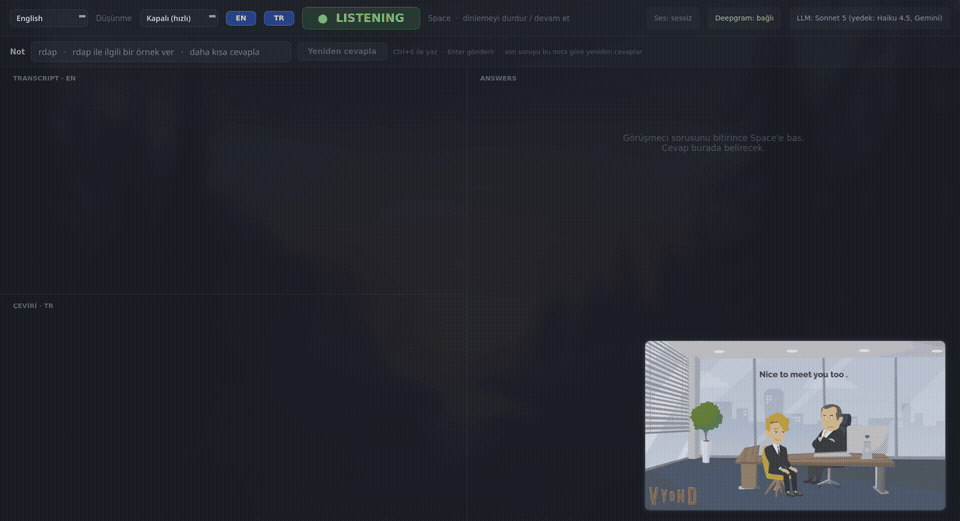
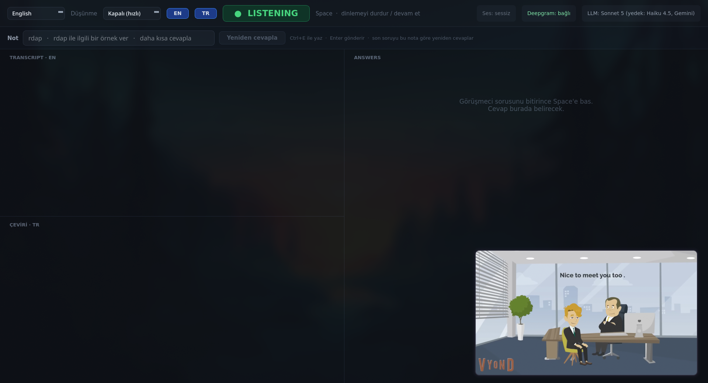
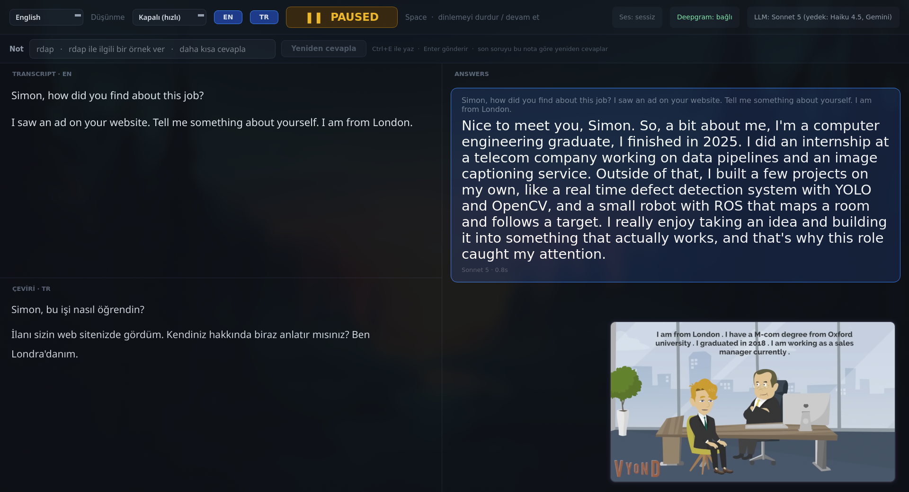

# InterviewPilot

**[English](#english) · [Türkçe](#turkce)**



▶ [Demo video (MP4, with sound)](docs/demo.mp4)

| Listening / Dinleme | Answer / Cevap |
|---|---|
|  |  |

---

<a id="english"></a>

## English

A real-time desktop assistant for online job interviews. It listens to the call audio, transcribes the interviewer live, and when you press **Space** it shows a short, natural answer based on your CV and the job description.

In the demo, an English interview clip is played, the question *"Tell me something about yourself"* is transcribed and translated, and an answer appears in under a second.

### Features

- **Live transcription:** captures system audio (Teams, Zoom, Meet, browser, any app) with Deepgram Nova-3 streaming. Your microphone is never recorded.
- **Instant answers:** Claude streams the reply; the answer is usually prepared while the interviewer is still finishing, so it can appear the moment you press Space. Automatic fallback to a faster Claude model and Gemini.
- **10 interview languages:** English, Turkish, Mandarin Chinese, Hindi, Spanish, French, Arabic, Bengali, Portuguese and Russian. Speech recognition and answers switch together.
- **Live Turkish translation** of the interviewer's speech in a separate pane, without slowing the answers.
- **Interview memory:** the whole conversation is sent as a dialogue, so the model keeps context and does not repeat examples. Prompts are cached to cut cost.
- **Correction bar:** type a note (e.g. a misheard term or "shorter") and get a new answer to the same question.
- **Thinking modes:** off (fastest) or low / medium / high reasoning for harder questions.
- **Session records:** every conversation and every answer is saved to the `kayitlar/` folder.

### Requirements

- Linux with PulseAudio or PipeWire (`parec` from `pulseaudio-utils` / `pipewire-pulse`)
- Python 3.11+
- API keys (see below)

### Installation

```bash
git clone https://github.com/koesan/InterviewPilot-v2.git
cd InterviewPilot-v2
python -m venv .venv
.venv/bin/pip install -r requirements.txt
cp .env.example .env
```

Open `.env` and add your API keys:

```env
DEEPGRAM_API_KEY=your-deepgram-key
ANTHROPIC_API_KEY=your-claude-key
GEMINI_API_KEY=your-gemini-key
```

| Key | Used for | Where to get it | Required |
|---|---|---|---|
| `DEEPGRAM_API_KEY` | Speech-to-text (turns the interviewer's voice into text) | [console.deepgram.com](https://console.deepgram.com) → API Keys. You can try the models at [playground.deepgram.com](https://playground.deepgram.com). New accounts get free credit. | Yes |
| `ANTHROPIC_API_KEY` | Claude API: answers and live translation (main model) | [console.anthropic.com](https://console.anthropic.com/settings/keys) → API Keys | At least one of Claude / Gemini |
| `GEMINI_API_KEY` | Google Gemini API: backup for answers and translation | [aistudio.google.com/apikey](https://aistudio.google.com/apikey) | At least one of Claude / Gemini |

With only Gemini the app works, but answers come from Gemini and thinking modes have no effect. Using both is recommended: Claude answers, Gemini steps in if Claude fails.

Then start the app:

```bash
./run.sh
```

### Configuration

The model reads three texts from `promptlar/`. Copy the examples and edit them with your own information:

```bash
cd promptlar
cp cv.example.txt cv.txt          # your CV
cp job.example.txt job.txt        # the company and the role
cp prompt.example.txt prompt.txt  # answer style and rules (optional)
```

The `*_tr.txt` files are used in Turkish mode; every other language uses the English files. Your own `*.txt` files are git-ignored; when one is missing, the `.example.txt` version is used.

Optional settings in `.env`:

| Variable | Default | Purpose |
|---|---|---|
| `CLAUDE_MODEL` | `claude-sonnet-5` | Main answer model |
| `CLAUDE_BACKUP_MODEL` | `claude-haiku-4-5-20251001` | Fast backup (`none` to disable) |
| `GEMINI_MODEL` | `gemini-3.5-flash-lite` | Last fallback |
| `TRANSLATE_MODEL` | `claude-haiku-5-5` | Translation model |
| `DEEPGRAM_MODEL` | `nova-3` | Speech-to-text model |
| `AUDIO_SOURCE` | `@DEFAULT_MONITOR@` | Audio source (`pactl list short sources`) |
| `DEEPGRAM_KEYTERMS` | | Comma-separated names and technical terms to boost recognition |

### Usage

1. Start the app before the call; it opens in **LISTENING** mode. The **Sound** indicator in the top bar shows whether call audio is coming in. If it stays silent while the interviewer talks, make your call app's output the default output device.
2. Select the interview language from the top-left menu. **EN / TR** buttons show or hide the transcript and the translation panes.
3. When the interviewer finishes a question, press **Space**. The answer appears on the right and listening pauses. Read it aloud.
4. Press **Space** again to continue listening.
5. If an answer misses the point, press **Ctrl+E**, type a note (Turkish or English, e.g. a misheard word or "shorter") and press **Enter**. A new answer to the same question appears.
6. Pick a **thinking** level for harder questions; the first word comes later but the answer is more careful.

Each answer card shows the model and the time from Space to the first word ("hazırdı" means it was prepared in advance).

Space works only while the app window is focused. For a global hotkey, bind `toggle.sh` in your window manager, e.g. in Hyprland:

```
bind = , F8, exec, /path/to/InterviewPilot-v2/toggle.sh
```

### Records

Every session is saved to the `kayitlar/` folder, line by line while you talk, so nothing is lost even if the app crashes:

- `YYYY-MM-DD_HH-MM_transkript.txt`: everything the interviewer said, with timestamps, and where you asked for an answer.
- `YYYY-MM-DD_HH-MM_cevaplar.txt`: every answer with its number, time, model, correction note and question.

The folder is empty in the repository; your records are git-ignored. The app log is written to `assistant.log`.

### Project structure

| File | Role |
|---|---|
| `main.py` | Entry point: Qt on the main thread, audio and network on an asyncio thread |
| `core.py` | Orchestration: listening state, early answers, retries |
| `audio.py` | System audio capture with `parec` |
| `stt.py` | Deepgram streaming client with reconnects |
| `llm.py` | Answer generation, prompt caching and provider fallback |
| `translate.py` | Live translation pane |
| `conversation.py` | Interview history |
| `languages.py` | Supported languages |
| `ui.py`, `style.qss` | Interface and dark theme |
| `records.py` | Session transcript and answer records |
| `config.py` | Settings and tunables |

### Tests

```bash
.venv/bin/pip install pytest
.venv/bin/python -m pytest tests
```

### Disclaimer

This project is intended for interview practice and research. Check the rules of any interview you take part in and use it responsibly.

**[↑ Top](#interviewpilot) · [Türkçe ↓](#turkce)**

---

<a id="turkce"></a>

## Türkçe

Online iş görüşmeleri için gerçek zamanlı masaüstü asistanı. Görüşmenin sesini dinler, görüşmecinin konuşmasını canlı olarak yazıya döker ve **Space**'e bastığınızda CV'nize ve iş ilanına uygun, kısa ve doğal bir cevap gösterir.

Demoda İngilizce bir mülakat videosu oynatılır, *"Tell me something about yourself"* sorusu yazıya dökülüp çevrilir ve cevap bir saniyeden kısa sürede gelir.

### Özellikler

- **Canlı transkript:** Sistem sesini (Teams, Zoom, Meet, tarayıcı, her uygulama) Deepgram Nova-3 ile anlık yazıya döker. Mikrofonunuz kaydedilmez.
- **Anında cevap:** Claude cevabı akış halinde yazar; cevap çoğu zaman görüşmeci konuşmasını bitirirken hazırlanır, Space'e bastığınız anda görünür. Daha hızlı bir Claude modeline ve Gemini'ye otomatik geçiş.
- **10 mülakat dili:** İngilizce, Türkçe, Çince (Mandarin), Hintçe, İspanyolca, Fransızca, Arapça, Bengalce, Portekizce ve Rusça. Konuşma tanıma ve cevap dili birlikte değişir.
- **Canlı Türkçe çeviri:** Görüşmecinin konuşması ayrı bir bölmede Türkçeye çevrilir, cevapları yavaşlatmaz.
- **Mülakat hafızası:** Tüm görüşme diyalog olarak modele gider; bağlam korunur, aynı örnek tekrar kullanılmaz. Maliyeti düşürmek için prompt önbelleğe alınır.
- **Not çubuğu:** Yanlış duyulan bir terimi veya "daha kısa" gibi bir notu yazın, aynı soruya yeni cevap alın.
- **Düşünme modları:** Kapalı (en hızlı) veya zor sorular için low / medium / high.
- **Oturum kayıtları:** Tüm konuşmalar ve cevaplar `kayitlar/` klasörüne kaydedilir.

### Gereksinimler

- PulseAudio veya PipeWire kullanan Linux (`parec`: `pulseaudio-utils` / `pipewire-pulse`)
- Python 3.11+
- API anahtarları (aşağıda)

### Kurulum

```bash
git clone https://github.com/koesan/InterviewPilot-v2.git
cd InterviewPilot-v2
python -m venv .venv
.venv/bin/pip install -r requirements.txt
cp .env.example .env
```

`.env` dosyasını açıp API anahtarlarınızı ekleyin:

```env
DEEPGRAM_API_KEY=deepgram-anahtariniz
ANTHROPIC_API_KEY=claude-anahtariniz
GEMINI_API_KEY=gemini-anahtariniz
```

| Anahtar | Ne için | Nereden alınır | Zorunlu |
|---|---|---|---|
| `DEEPGRAM_API_KEY` | Ses → yazı (görüşmecinin sesini metne çevirir) | [console.deepgram.com](https://console.deepgram.com) → API Keys. Modelleri [playground.deepgram.com](https://playground.deepgram.com) üzerinde deneyebilirsiniz. Yeni hesaplara ücretsiz kredi verilir. | Evet |
| `ANTHROPIC_API_KEY` | Claude API: cevaplar ve canlı çeviri (ana model) | [console.anthropic.com](https://console.anthropic.com/settings/keys) → API Keys | Claude / Gemini'den en az biri |
| `GEMINI_API_KEY` | Google Gemini API: cevap ve çeviri için yedek | [aistudio.google.com/apikey](https://aistudio.google.com/apikey) | Claude / Gemini'den en az biri |

Yalnızca Gemini ile de çalışır, ama cevaplar Gemini'den gelir ve düşünme modları etkisiz olur. İkisini birlikte kullanmanız önerilir: Claude cevaplar, Claude hata verirse Gemini devreye girer.

Ardından uygulamayı başlatın:

```bash
./run.sh
```

### Yapılandırma

Model `promptlar/` klasöründeki üç metni okur. Örnekleri kopyalayıp kendi bilgilerinizle düzenleyin:

```bash
cd promptlar
cp cv.example.txt cv.txt          # CV'niz
cp job.example.txt job.txt        # şirket ve pozisyon
cp prompt.example.txt prompt.txt  # cevap tarzı ve kurallar (isteğe bağlı)
```

`*_tr.txt` dosyaları Türkçe modda kullanılır; diğer tüm diller İngilizce dosyaları kullanır. Kendi `*.txt` dosyalarınız git'e eklenmez; biri yoksa `.example.txt` sürümü kullanılır.

`.env` içindeki isteğe bağlı ayarlar:

| Değişken | Varsayılan | Amaç |
|---|---|---|
| `CLAUDE_MODEL` | `claude-sonnet-5` | Ana cevap modeli |
| `CLAUDE_BACKUP_MODEL` | `claude-haiku-4-5-20251001` | Hızlı yedek (`none` = kapalı) |
| `GEMINI_MODEL` | `gemini-3.5-flash-lite` | Son yedek |
| `TRANSLATE_MODEL` | `claude-haiku-5-5` | Çeviri modeli |
| `DEEPGRAM_MODEL` | `nova-3` | Konuşma tanıma modeli |
| `AUDIO_SOURCE` | `@DEFAULT_MONITOR@` | Ses kaynağı (`pactl list short sources`) |
| `DEEPGRAM_KEYTERMS` | | Tanımayı güçlendirmek için virgülle ayrılmış isim ve teknik terimler |

### Kullanım

1. Uygulamayı görüşmeden önce başlatın; **LISTENING** modunda açılır. Üst bardaki **Ses: geliyor / sessiz** göstergesi görüşme sesinin gelip gelmediğini gösterir. Görüşmeci konuşurken "sessiz" yazıyorsa görüşme uygulamasının ses çıkışını varsayılan çıkış yapın.
2. Sol üstteki menüden mülakat dilini seçin. **EN / TR** düğmeleri transkript ve çeviri bölmelerini açıp kapatır.
3. Görüşmeci sorusunu bitirince **Space**'e basın. Cevap sağda belirir ve dinleme duraklar. Cevabı sesli okuyun.
4. Dinlemeye devam etmek için tekrar **Space**'e basın.
5. Cevap amacı kaçırırsa **Ctrl+E** ile not yazın (Türkçe veya İngilizce; yanlış duyulan bir kelime ya da "daha kısa" gibi) ve **Enter**'a basın. Aynı soruya yeni bir cevap gelir.
6. Zor sorular için **Düşünme** seviyesi seçin; ilk kelime daha geç gelir ama cevap daha özenli olur.

Her cevap kartında model ve Space'ten ilk kelimeye kadar geçen süre yazar ("hazırdı" = önceden hazırlanmış).

Space yalnızca uygulama penceresi aktifken çalışır. Global kısayol için `toggle.sh`'ı pencere yöneticinize bağlayın, örneğin Hyprland'de:

```
bind = , F8, exec, /path/to/InterviewPilot-v2/toggle.sh
```

### Kayıtlar

Her oturum `kayitlar/` klasörüne, konuşma sürerken satır satır kaydedilir; uygulama çökse bile o ana kadarki kayıt kalır:

- `YYYY-AA-GG_SS-DD_transkript.txt`: görüşmecinin söylediği her şey saatiyle ve cevap istediğiniz yerler.
- `YYYY-AA-GG_SS-DD_cevaplar.txt`: her cevap; numarası, saati, modeli, düzeltme notu ve sorusuyla.

Klasör repoda boştur; kendi kayıtlarınız git'e eklenmez. Uygulama logu `assistant.log` dosyasına yazılır.

### Proje yapısı

| Dosya | Görev |
|---|---|
| `main.py` | Başlatma: Qt ana thread'de, ses ve ağ işleri asyncio thread'inde |
| `core.py` | Orkestrasyon: dinleme durumu, önceden cevap, yeniden cevaplama |
| `audio.py` | `parec` ile sistem sesi yakalama |
| `stt.py` | Yeniden bağlanan Deepgram akış istemcisi |
| `llm.py` | Cevap üretimi, prompt önbelleği ve sağlayıcı yedeği |
| `translate.py` | Canlı çeviri bölmesi |
| `conversation.py` | Mülakat geçmişi |
| `languages.py` | Desteklenen diller |
| `ui.py`, `style.qss` | Arayüz ve koyu tema |
| `records.py` | Oturum transkript ve cevap kayıtları |
| `config.py` | Ayarlar |

### Testler

```bash
.venv/bin/pip install pytest
.venv/bin/python -m pytest tests
```

### Uyarı

Bu proje mülakat pratiği ve araştırma amaçlıdır. Katıldığınız görüşmenin kurallarını kontrol edin ve sorumlu şekilde kullanın.

**[↑ Başa dön](#interviewpilot) · [English ↑](#english)**

---

## License / Lisans

[MIT](LICENSE)
