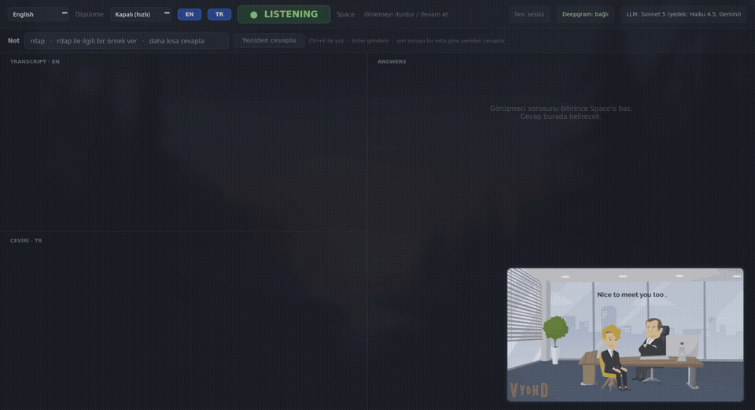
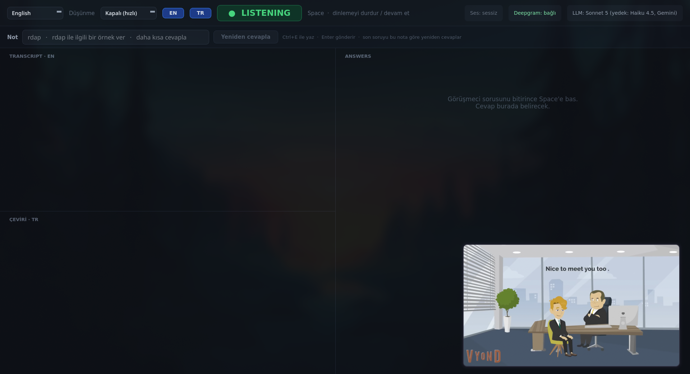
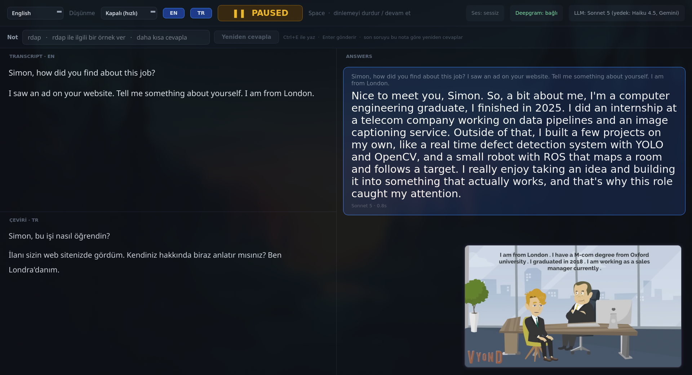

# InterviewPilot

[English](README.md) · **Türkçe**

Online iş görüşmeleri için gerçek zamanlı masaüstü asistanı. Görüşmenin sesini dinler, görüşmecinin konuşmasını canlı olarak yazıya döker ve **Space**'e bastığınızda CV'nize ve iş ilanına uygun, kısa ve doğal bir cevap gösterir.



▶ [Tam demo videosu (MP4, sesli)](docs/demo.mp4): İngilizce bir mülakat videosu oynatılır, *"Tell me something about yourself"* sorusu yazıya dökülüp çevrilir ve cevap bir saniyeden kısa sürede gelir.

## Özellikler

- **Canlı transkript:** Sistem sesini (Teams, Zoom, Meet, tarayıcı, her uygulama) Deepgram Nova-3 ile anlık yazıya döker. Mikrofonunuz kaydedilmez.
- **Anında cevap:** Claude cevabı akış halinde yazar; cevap çoğu zaman görüşmeci konuşmasını bitirirken hazırlanır, Space'e bastığınız anda görünür. Daha hızlı bir Claude modeline ve Gemini'ye otomatik geçiş.
- **10 mülakat dili:** İngilizce, Türkçe, Çince (Mandarin), Hintçe, İspanyolca, Fransızca, Arapça, Bengalce, Portekizce ve Rusça. Konuşma tanıma ve cevap dili birlikte değişir.
- **Canlı Türkçe çeviri:** Görüşmecinin konuşması ayrı bir bölmede Türkçeye çevrilir, cevapları yavaşlatmaz.
- **Mülakat hafızası:** Tüm görüşme diyalog olarak modele gider; bağlam korunur, aynı örnek tekrar kullanılmaz. Maliyeti düşürmek için prompt önbelleğe alınır.
- **Not çubuğu:** Yanlış duyulan bir terimi veya "daha kısa" gibi bir notu yazın, aynı soruya yeni cevap alın.
- **Düşünme modları:** Kapalı (en hızlı) veya zor sorular için low / medium / high.
- **Oturum kayıtları:** Her oturum için saatli transkript ve cevap dosyası yazılır.

| Dinleme | Cevap |
|---|---|
|  |  |

## Gereksinimler

- PulseAudio veya PipeWire kullanan Linux (`parec`: `pulseaudio-utils` / `pipewire-pulse`)
- Python 3.11+
- API anahtarları: [Deepgram](https://deepgram.com) (zorunlu) ve [Anthropic](https://console.anthropic.com) ve/veya [Google Gemini](https://aistudio.google.com)

## Kurulum

```bash
git clone https://github.com/koesan/InterviewPilot-v2.git
cd InterviewPilot-v2
python -m venv .venv
.venv/bin/pip install -r requirements.txt
cp .env.example .env        # API anahtarlarınızı ekleyin
./run.sh
```

## Yapılandırma

Model `promptlar/` klasöründeki üç metni okur. Örnekleri kopyalayıp kendi bilgilerinizle düzenleyin:

```bash
cd promptlar
cp cv.example.txt cv.txt          # CV'niz
cp job.example.txt job.txt        # şirket ve pozisyon
cp prompt.example.txt prompt.txt  # cevap tarzı ve kurallar (isteğe bağlı)
```

`*_tr.txt` dosyaları Türkçe modda kullanılır; diğer tüm diller İngilizce dosyaları kullanır. Kendi `*.txt` dosyalarınız git'e eklenmez; biri yoksa `.example.txt` sürümü kullanılır.

`.env` içindeki isteğe bağlı ayarlar:

| Değişken | Varsayılan | Amaç |
|---|---|---|
| `CLAUDE_MODEL` | `claude-sonnet-5` | Ana cevap modeli |
| `CLAUDE_BACKUP_MODEL` | `claude-haiku-4-5-20251001` | Hızlı yedek (`none` = kapalı) |
| `GEMINI_MODEL` | `gemini-3.5-flash-lite` | Son yedek |
| `TRANSLATE_MODEL` | `claude-haiku-5-5` | Çeviri modeli |
| `DEEPGRAM_MODEL` | `nova-3` | Konuşma tanıma modeli |
| `AUDIO_SOURCE` | `@DEFAULT_MONITOR@` | Ses kaynağı (`pactl list short sources`) |
| `DEEPGRAM_KEYTERMS` | | Tanımayı güçlendirmek için virgülle ayrılmış isim ve teknik terimler |

## Kullanım

1. Uygulamayı görüşmeden önce başlatın; **LISTENING** modunda açılır.
2. Sol üstteki menüden mülakat dilini seçin.
3. Görüşmeci sorusunu bitirince **Space**'e basın. Cevap sağda belirir ve dinleme duraklar.
4. Dinlemeye devam etmek için tekrar **Space**'e basın.
5. Cevap amacı kaçırırsa **Ctrl+E** ile not yazıp **Enter**'a basın.

Space yalnızca uygulama penceresi aktifken çalışır. Global kısayol için `toggle.sh`'ı pencere yöneticinize bağlayın, örneğin Hyprland'de:

```
bind = , F8, exec, /path/to/InterviewPilot-v2/toggle.sh
```

## Proje yapısı

| Dosya | Görev |
|---|---|
| `main.py` | Başlatma: Qt ana thread'de, ses ve ağ işleri asyncio thread'inde |
| `core.py` | Orkestrasyon: dinleme durumu, önceden cevap, yeniden cevaplama |
| `audio.py` | `parec` ile sistem sesi yakalama |
| `stt.py` | Yeniden bağlanan Deepgram akış istemcisi |
| `llm.py` | Cevap üretimi, prompt önbelleği ve sağlayıcı yedeği |
| `translate.py` | Canlı çeviri bölmesi |
| `conversation.py` | Mülakat geçmişi |
| `languages.py` | Desteklenen diller |
| `ui.py`, `style.qss` | Arayüz ve koyu tema |
| `records.py` | Oturum transkript ve cevap kayıtları |
| `config.py` | Ayarlar |

## Testler

```bash
.venv/bin/pip install pytest
.venv/bin/python -m pytest tests
```

## Uyarı

Bu proje mülakat pratiği ve araştırma amaçlıdır. Katıldığınız görüşmenin kurallarını kontrol edin ve sorumlu şekilde kullanın.

## Lisans

[MIT](LICENSE)
